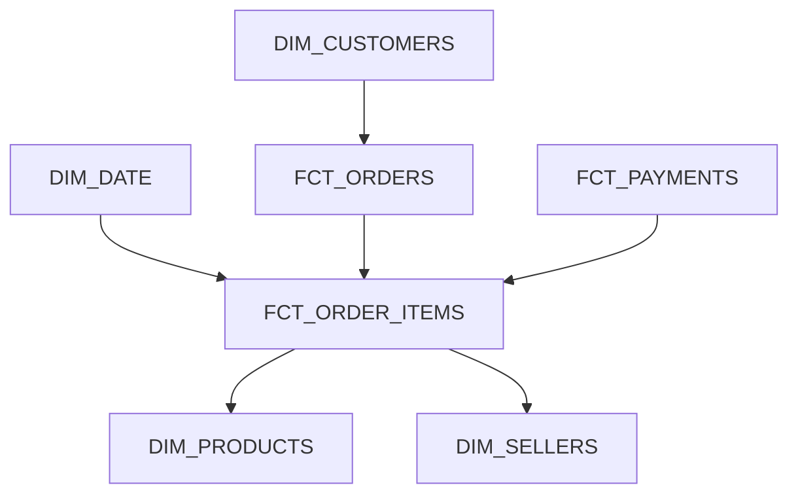

# Proposed Dimensional Model

# Design Questions

**Question 1 - Raw Data Storage**  
*Why are we storing source CSV files in AWS S3 instead of loading them directly into Snowflake and discarding the original files?*  
- 

**Question 2 - Orchestration versus transformation**
*Why do we need both Airflow and SQLMesh?*  
- Apache Airflow is being used for orchestration. It is what gets our source data into storage so it can be transformed.
- SQLMesh is being used for transformation. Once the data has been loaded, we use SQLMesh models to perform transformations on the data.,

**Question 3 - Data modeling**  
*What could go wrong if we join the order items and payment records directly using `order_id` and then calculate total sales?
- `order_id` is not unique within the table, so we will get duplicate sales amounts, causing the total sales to be larger than what is actually correct.  
*How might we prevent that problem?*  
- In our model we must use a different grain, for example, a grain of (`order_id`, `product_id`) would give us a unique set of rows that we can calculate the total sales amount from.